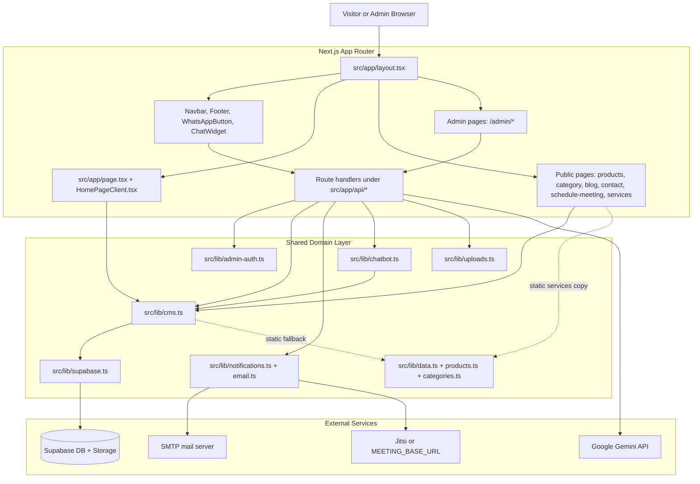
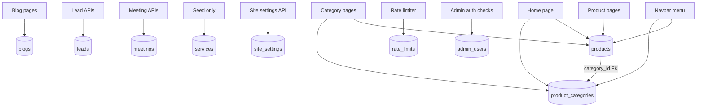

# Project Knowledge Graph

Snapshot source: current workspace state on 2026-03-25.

Purpose: keep a stable mental model of this codebase so future changes can start from the right files instead of rescanning the whole repo.

## High-Level Graph



## Runtime Model

- Public shell: `src/app/layout.tsx` mounts Navbar, Footer, WhatsApp button, toast system, and client-only chat widget.
- Public content path: server components read catalog/category/blog/settings through `src/lib/cms.ts`.
- Public interaction path: contact form, lead popup, meeting form, and chat widget post to `/api/leads`, `/api/meetings`, `/api/chat`.
- Admin path: `/admin/*` is guarded by `src/middleware.ts` and `src/lib/admin-auth.ts`; admin UI is client-driven and talks to REST-like API routes.
- Admin identity path: login still enters through NextAuth, but credentials are now verified against Supabase Auth and access is allowlisted through `public.admin_users`.
- Data access path: all database reads/writes funnel through `src/lib/cms.ts`, which is the main repository layer.
- Infra path: `src/lib/supabase.ts` creates public and service-role clients; `src/lib/uploads.ts` uses Supabase Storage or falls back to `public/uploads`.

## Public Page Graph

```mermaid
flowchart LR
  Home[src/app/page.tsx] --> CMS1[listProducts]
  Home --> CMS2[listCategories]
  Home --> CMS3[getSiteSetting hero_carousel_overrides]

  Product[src/app/products/[slug]/page.tsx] --> CMS4[getProductBySlug]
  Product --> CMS5[listProducts]

  Category[src/app/products/category/[slug]/page.tsx] --> CMS6[listProducts]
  Category --> CMS7[listCategories]
  Category --> CMS8[getCatalogPath]

  BlogIndex[src/app/blog/page.tsx] --> CMS9[listBlogs]
  BlogPost[src/app/blog/[slug]/page.tsx] --> CMS10[getBlogBySlug]
  Services[src/app/services/page.tsx] --> CMS11[getCatalogPath]
  Services -. body copy .-> DATA1[src/lib/data.ts SERVICES]
  Footer[src/components/layout/Footer.tsx] --> CMS12[listProducts + getCatalogPath]
  Navbar[src/components/layout/Navbar.tsx] --> API1[/api/products]
  Navbar --> API2[/api/categories]
  Navbar --> API3[/api/site-settings]
```

## Mutation Graph

```mermaid
flowchart TD
  ContactForm[src/app/contact/page.tsx] --> LeadsAPI[/api/leads]
  HomePopup[src/app/HomePageClient.tsx] --> LeadsAPI
  ProductCTA[src/app/products/[slug]/ProductPageClient.tsx] --> LeadsAPI
  ChatLead[src/components/chatbot/ChatWidget.tsx] --> LeadsAPI

  MeetingPage[src/app/schedule-meeting/page.tsx] --> MeetingsAPI[/api/meetings]
  ChatMeeting[src/components/chatbot/ChatWidget.tsx] --> MeetingsAPI

  LeadsAPI --> CMSLead[createLead]
  LeadsAPI --> MailLead[sendCatalogEmail or sendContactThankYouEmail]

  MeetingsAPI --> CMSMeeting[createMeeting]
  MeetingsAPI --> MeetingLink[buildMeetingLink]
  MeetingsAPI --> MailMeeting[sendMeetingScheduledEmail]

  AdminProducts[/api/products + /api/products/[id]] --> CMSProducts[product CRUD]
  AdminCategories[/api/categories + /api/categories/[id]] --> CMSCategories[category CRUD]
  AdminBlogs[/api/blogs + /api/blogs/[id]] --> CMSBlogs[blog CRUD]
  AdminSettings[/api/site-settings] --> CMSSettings[site settings upsert]
  AdminUploads[/api/admin/uploads] --> Uploads[storeUploadedImage]
```

## API Ownership Map

- `/api/auth/[...nextauth]`: NextAuth session wrapper around Supabase Auth password login + `admin_users` allowlist lookup.
- `/api/products`: public published list; admin full list + create.
- `/api/products/[id]`: admin get/update/delete.
- `/api/categories`: public published list; admin full list + create.
- `/api/categories/[id]`: admin get/update/delete.
- `/api/blogs`: public published list; admin full list + create.
- `/api/blogs/[id]`: admin get/update/delete.
- `/api/leads`: public create; admin list.
- `/api/leads/[id]`: admin mark-read or delete.
- `/api/meetings`: public create; admin list.
- `/api/meetings/[id]`: admin get/update.
- `/api/site-settings`: public gets `catalogPath` and hero overrides; admin gets full settings and can upsert.
- `/api/chat`: public chatbot entrypoint, Gemini-enhanced with local catalog fallback.
- `/api/admin/uploads`: admin-only file upload.
- `/api/admin/status`: admin-only Supabase connection health.

## Database Graph



## Tables and Real Usage

- `products`: core catalog source for public pages, navbar, footer, chatbot, admin.
- `product_categories`: used to order/group product categories and drive homepage/category pages.
- `blogs`: used by blog index, blog detail, admin blog CRUD.
- `leads`: written publicly, read/updated/deleted by admin.
- `meetings`: written publicly, read/updated by admin.
- `site_settings`: currently used for `catalog_path` and `hero_carousel_overrides`.
- `admin_users`: maps Supabase Auth users to admin access and roles.
- `rate_limits`: distributed request counters for public write/auth endpoints in serverless and multi-instance deployments.
- `services`: exists in schema and seed, but live app renders services from `src/lib/data.ts`, not from database.

## Change Impact Map

If you need to change product data:
- `src/lib/products.ts`
- `src/lib/data.ts`
- `src/lib/cms.ts`
- `src/app/products/[slug]/page.tsx`
- `src/app/products/category/[slug]/page.tsx`
- `src/components/layout/Navbar.tsx`
- `scripts/seed-supabase.ts`
- `supabase/schema.sql`

If you need to change homepage hero/category behavior:
- `src/app/page.tsx`
- `src/app/HomePageClient.tsx`
- `src/lib/home-hero.ts`
- `src/lib/cms.ts`
- `src/app/api/site-settings/route.ts`

If you need to change admin login/security:
- `src/middleware.ts`
- `src/lib/admin-auth.ts`
- `src/lib/admin-users.ts`
- `src/app/api/auth/[...nextauth]/route.ts`
- `src/lib/supabase.ts`
- `supabase/schema.sql`
- `supabase/migrations/20260325_supabase_auth_and_product_categories.sql`

If you need to change lead flow:
- `src/app/contact/page.tsx`
- `src/app/HomePageClient.tsx`
- `src/app/products/[slug]/ProductPageClient.tsx`
- `src/components/chatbot/ChatWidget.tsx`
- `src/app/api/leads/route.ts`
- `src/app/api/leads/[id]/route.ts`
- `src/lib/cms.ts`
- `src/lib/notifications.ts`

If you need to change meeting flow:
- `src/app/schedule-meeting/page.tsx`
- `src/components/chatbot/ChatWidget.tsx`
- `src/app/api/meetings/route.ts`
- `src/app/api/meetings/[id]/route.ts`
- `src/lib/cms.ts`
- `src/lib/notifications.ts`

If you need to change chatbot behavior:
- `src/components/chatbot/ChatWidget.tsx`
- `src/app/api/chat/route.ts`
- `src/lib/chatbot.ts`
- `src/lib/cms.ts`

If you need to change upload behavior:
- `src/components/admin/ImageUploadField.tsx`
- `src/app/api/admin/uploads/route.ts`
- `src/lib/uploads.ts`
- `src/lib/supabase.ts`

## Design Strengths

- Clear separation between page/UI layer, API layer, and data/infra helpers.
- `src/lib/cms.ts` gives one repository-style entrypoint for most domain operations.
- Public pages degrade to static in-memory data when Supabase is unavailable.
- Supabase schema already includes RLS, updated-at triggers, and basic indexes.
- SEO-aware routing is present for products, categories, blog posts, sitemap, and city/machine landing pages.

## Design Weak Spots

- `src/lib/cms.ts` is a god-file for mapping, validation, fallback logic, and CRUD across all domains.
- Public server reads use the service-role client when available, so accidental overfetch in future code can bypass RLS.
- Services are modeled in DB but not actually consumed by the app, so schema and runtime have drift.
- `products` now carries both denormalized category text and authoritative `category_id`; writes depend on `product_categories`, so migrations must keep both in sync.
- `site_settings.value` is generic text and also stores JSON payloads, which weakens validation and makes settings contract implicit.

## Security Hotspots To Recheck First

- Secret handling: `.env`, `src/lib/supabase.ts`, `src/app/api/auth/[...nextauth]/route.ts`
- Public write endpoints: `/api/leads`, `/api/meetings`, `/api/chat`
- HTML email interpolation: `src/lib/notifications.ts`
- File upload and storage exposure: `src/app/api/admin/uploads/route.ts`, `src/lib/uploads.ts`
- Broad remote image trust: `next.config.js`

## DBA Hotspots To Recheck First

- RLS and policy behavior in `supabase/schema.sql`
- `admin_users` lifecycle versus Supabase Auth users
- Category consistency between `products.category_id`, `products.category`, and `product_categories`
- `services` table drift versus static `SERVICES` constant
- Index coverage for future lead/meeting filters and dashboards
- Backup/migration discipline because schema changes currently live in flat SQL files

## Fast Mental Model

- This is a marketing/catalog site with lightweight CMS capabilities.
- Public reads are mostly server-rendered; public writes are API-based.
- Admin uses Supabase Auth plus an allowlist table; it is still lightweight RBAC, not a full tenant-aware auth system.
- Supabase is both content store and operational store.
- Gemini is optional enhancement, not the source of truth.
- Static product/service data still matters because the app can fall back to it.
